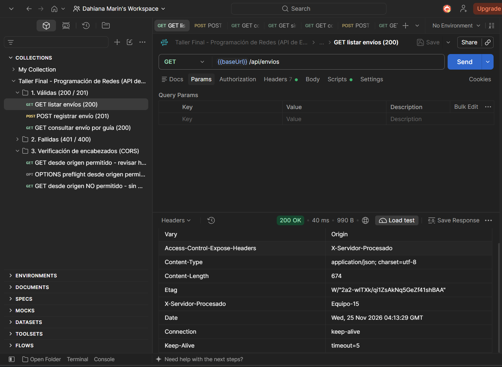
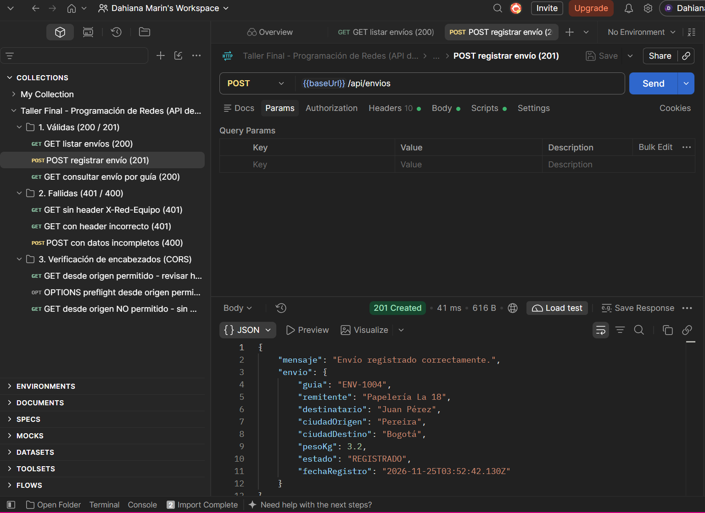
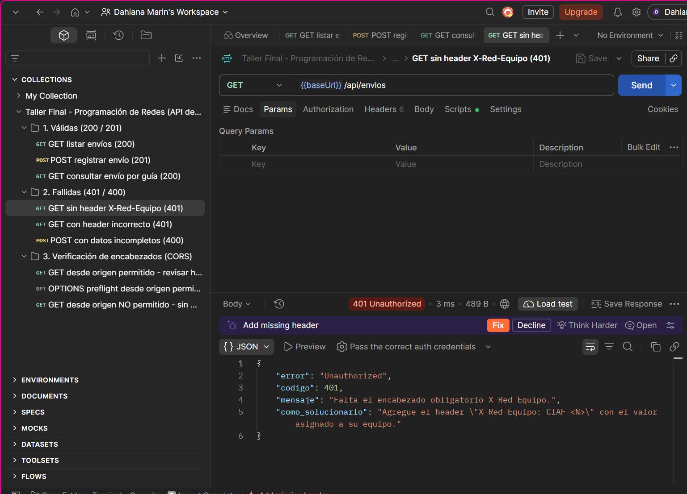
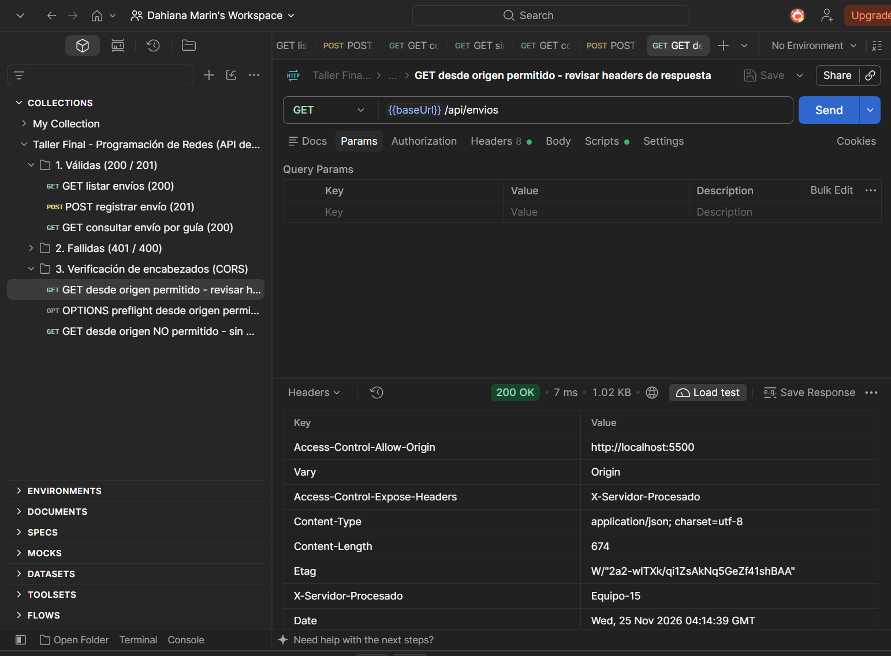
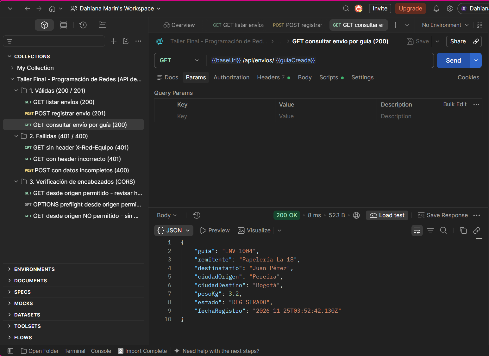

# API de Consulta y Registro de Envíos — Taller Final de Programación de Redes

**CIAF · Tecnología en Desarrollo de Software**
Tema: Protocolo HTTP, encabezados (headers), políticas CORS y seguridad en la comunicación.

---

## 1. Integrantes del equipo

Ordenados alfabéticamente por apellido según el listado oficial de asistencia (**Programación de redes - Grupo 1 miércoles**):

| # Lista oficial | Nombre completo |
|:---:|---|
| 15 | Marin Giraldo Dahiana |
| 16 | Moncada Castro Angel Stewar |

- **Valor de N:** `15` (número de lista de Marin Giraldo Dahiana, primera integrante en orden alfabético por apellido: **Ma**rin va antes de **Mo**ncada)
- **Encabezado obligatorio de petición:** `X-Red-Equipo: CIAF-15`
- **Encabezado de respuesta exitosa:** `X-Servidor-Procesado: Equipo-15`

---

## 2. Escenario de red

**Servicio:** API de una empresa de mensajería regional del Eje Cafetero que permite **consultar el estado de los envíos** (registrado, en tránsito, en reparto, entregado) y **registrar envíos nuevos** desde los puntos de atención.

**¿Qué cliente consume el servicio?**
- Un **navegador web**: el portal de rastreo que usan los clientes y los asesores en las sucursales (simulado en `cliente/index.html`, servido en `http://localhost:5500`). Por ser un navegador, aplica la política **CORS**, y por eso el servidor solo autoriza ese origen.
- A futuro, una **app móvil** de los mensajeros podría consumir los mismos endpoints para actualizar estados.

**Riesgos si el servicio viajara por HTTP sin cifrado:**
1. **Robo de la credencial:** el header `X-Red-Equipo` viaja en texto plano. Cualquiera en la misma red Wi-Fi (una sucursal, un café) lo puede capturar con Wireshark y usarlo para consumir la API.
2. **Exposición de datos personales:** nombres de remitente y destinatario, ciudades y, en un caso real, direcciones y teléfonos.
3. **Modificación en tránsito (Man-in-the-Middle):** un atacante podría cambiar la respuesta para mostrar que un paquete fue "ENTREGADO" cuando no lo fue, o alterar la ciudad de destino de un envío nuevo.
4. **Suplantación del servidor:** sin certificado, el cliente no puede comprobar que habla con el servidor real de la empresa.

---

## 3. Estructura del proyecto

```
taller-redes-envios/
├── src/
│   ├── server.js                    # Servidor Express (CORS, middlewares, arranque HTTP/HTTPS)
│   ├── config.js                    # Valor de N, headers y origen CORS permitido
│   ├── middleware/
│   │   ├── validarEquipo.js         # Valida X-Red-Equipo: CIAF-15  -> 401 si falla
│   │   └── encabezadoRespuesta.js   # Agrega X-Servidor-Procesado: Equipo-15 en respuestas 2xx
│   └── routes/
│       └── envios.js                # GET y POST /api/envios
├── cliente/
│   ├── index.html                   # Cliente web para probar CORS desde un navegador
│   └── servir-cliente.js            # Sirve el cliente en http://localhost:5500
├── postman/
│   └── Taller-Redes-Envios.postman_collection.json
├── capturas/                        # Capturas de pantalla de Postman
├── package.json
└── .gitignore                       # Excluye node_modules
```

---

## 4. Instalación y ejecución

Requisitos: Node.js 18 o superior.

```bash
npm install
npm start          # http://localhost:3000
```

El valor de N se define en `src/config.js` (o con la variable de entorno `N_EQUIPO`). Al arrancar, la consola muestra el header exacto que se espera:

```
HTTP  -> http://localhost:3000
Header requerido:  X-Red-Equipo: CIAF-15
Header de respuesta: X-Servidor-Procesado: Equipo-15
Origen CORS permitido: http://localhost:5500
```

Para probar CORS desde un navegador (en otra terminal):

```bash
npm run cliente    # abre http://localhost:5500 en el navegador
```

---

## 5. Endpoints

Todas las peticiones deben incluir `X-Red-Equipo: CIAF-15`.

| Método | Ruta | Descripción | Respuestas |
|---|---|---|---|
| GET | `/api/envios` | Lista todos los envíos (filtro opcional `?estado=EN_TRANSITO`) | 200, 400, 401 |
| GET | `/api/envios/:guia` | Consulta un envío por número de guía | 200, 404, 401 |
| POST | `/api/envios` | Registra un envío (cuerpo JSON) | 201, 400, 401 |

**Ejemplo de cuerpo para el POST:**

```json
{
  "remitente": "Papelería La 18",
  "destinatario": "Juan Pérez",
  "ciudadOrigen": "Pereira",
  "ciudadDestino": "Bogotá",
  "pesoKg": 3.2
}
```

**Respuesta 401 cuando falta el header:**

```json
{
  "error": "Unauthorized",
  "codigo": 401,
  "mensaje": "Falta el encabezado obligatorio X-Red-Equipo.",
  "como_solucionarlo": "Agregue el header \"X-Red-Equipo: CIAF-<N>\" con el valor asignado a su equipo."
}
```

---

## 6. Configuración de CORS

Se usa el middleware `cors` permitiendo **explícitamente un solo origen**:

```js
app.use(cors({
  origin: ['http://localhost:5500'],               // único origen autorizado
  methods: ['GET', 'POST'],
  allowedHeaders: ['Content-Type', 'X-Red-Equipo'], // el navegador puede enviar nuestro header
  exposedHeaders: ['X-Servidor-Procesado'],          // el JS del navegador puede leer nuestro header
  maxAge: 600,
}));
```

**Encabezados que devuelve el servidor:**

| Situación | Encabezado de respuesta |
|---|---|
| Petición con `Origin: http://localhost:5500` | `Access-Control-Allow-Origin: http://localhost:5500` |
| Petición con otro `Origin` (ej. `http://sitio-malicioso.com`) | **No** se envía `Access-Control-Allow-Origin`, y el navegador bloquea la lectura de la respuesta |
| Preflight `OPTIONS` del origen permitido | `204 No Content` + `Access-Control-Allow-Origin`, `Access-Control-Allow-Methods: GET,POST`, `Access-Control-Allow-Headers: Content-Type,X-Red-Equipo` |
| Siempre | `Access-Control-Expose-Headers: X-Servidor-Procesado` y `Vary: Origin` |

> El middleware `cors` va **antes** de la validación de `X-Red-Equipo`. El preflight `OPTIONS` lo envía el navegador automáticamente y **no incluye headers personalizados**. Si se validara primero, el preflight recibiría 401 y el navegador nunca enviaría la petición real.

---

## 7. Colección de Postman

Archivo: [`postman/Taller-Redes-Envios.postman_collection.json`](postman/Taller-Redes-Envios.postman_collection.json)
Importar en Postman: **Import → seleccionar el archivo**. La variable de colección `equipo` ya viene configurada con `CIAF-15`.

| Carpeta | Petición | Resultado esperado |
|---|---|---|
| 1. Válidas | GET listar envíos | **200** + `X-Servidor-Procesado: Equipo-15` |
| 1. Válidas | POST registrar envío | **201** + header `Location` |
| 1. Válidas | GET consultar por guía | **200** |
| 2. Fallidas | GET **sin** header `X-Red-Equipo` | **401** + JSON explicativo |
| 2. Fallidas | GET con header incorrecto (`CIAF-999`) | **401** |
| 2. Fallidas | POST con datos incompletos | **400** + lista de campos faltantes |
| 3. Verificación de encabezados | GET con `Origin` permitido | `Access-Control-Allow-Origin: http://localhost:5500` |
| 3. Verificación de encabezados | OPTIONS preflight | **204** + headers CORS |
| 3. Verificación de encabezados | GET con `Origin` no permitido | **sin** `Access-Control-Allow-Origin` |

Cada petición trae **tests automáticos** (pestaña *Tests*/*Scripts*). Con *Run collection* se ejecutan todas y se ve cuáles pasan.

> **Nota:** Postman **no es un navegador**, así que no aplica CORS y siempre muestra la respuesta. Lo que se verifica en Postman es qué headers CORS envía el servidor. El bloqueo real se ve en el navegador con `cliente/index.html`.

---

## 8. Capturas de pantalla

### Respuesta exitosa (200) con headers de respuesta visibles


### Registro de envío (201)


### Respuesta 401 al omitir el encabezado X-Red-Equipo


### Verificación de Access-Control-Allow-Origin


### Consulta de un envío por número de guía (200)


---

## 9. Análisis teórico aplicado

### 9.1 Viaje de la petición en el modelo TCP/IP

Ejemplo: Postman envía `GET http://localhost:3000/api/envios` con el header `X-Red-Equipo: CIAF-15`.

```
 POSTMAN (cliente)                                     EXPRESS (servidor :3000)
 ┌──────────────────────┐                              ┌──────────────────────┐
 │ 4. Aplicación  (HTTP)│  GET /api/envios + headers   │ Aplicación (HTTP)    │ → cors → validarEquipo → ruta
 ├──────────────────────┤                              ├──────────────────────┤
 │ 3. Transporte  (TCP) │  puerto origen 5xxxx → 3000  │ Transporte (TCP)     │
 ├──────────────────────┤                              ├──────────────────────┤
 │ 2. Internet    (IP)  │  127.0.0.1 → 127.0.0.1       │ Internet (IP)        │
 ├──────────────────────┤                              ├──────────────────────┤
 │ 1. Acceso a Red      │  interfaz loopback / Wi-Fi   │ Acceso a Red         │
 └──────────┬───────────┘                              └──────────▲───────────┘
            └────────────────────── medio ─────────────────────────┘
```

| Capa TCP/IP | Qué pasa con nuestra petición | Datos / unidad |
|---|---|---|
| **Aplicación** | Postman arma el mensaje HTTP: línea de petición (`GET /api/envios HTTP/1.1`), headers (`Host`, `X-Red-Equipo`, `Content-Type`, `Origin`) y, en el POST, el cuerpo JSON. En el servidor, Express lee ese mensaje, pasa por los middlewares (`cors`, `validarEquipo`) y genera la respuesta (código de estado, headers como `X-Servidor-Procesado` y `Access-Control-Allow-Origin`, y el JSON). Si se usa HTTPS, TLS cifra el mensaje en este nivel, justo antes de entregarlo a TCP. | Mensaje HTTP |
| **Transporte** | TCP establece la conexión con el *three-way handshake* (SYN → SYN-ACK → ACK) entre un puerto efímero del cliente (ej. 53412) y el **puerto 3000** donde escucha Node. Divide el mensaje en segmentos, los numera, confirma su recepción (ACK) y retransmite si se pierden. Así el JSON llega completo y en orden. | Segmento TCP |
| **Internet** | IP pone la dirección origen y destino en cada paquete. En nuestras pruebas ambas son `127.0.0.1` (localhost). Si el servidor estuviera en otra máquina de la red (ej. `192.168.1.20`) o en Internet, los routers usarían la IP destino para encaminar el paquete. | Paquete / datagrama IP |
| **Acceso a Red** | En localhost el paquete no sale a ningún cable: el sistema operativo lo entrega por la **interfaz de loopback**. En una red real se encapsula en una **trama** Ethernet o Wi-Fi con direcciones **MAC** (resueltas con ARP) y se transmite como señales eléctricas o de radio. | Trama / bits |

En el servidor el proceso se invierte (**desencapsulación**): la tarjeta de red recibe la trama, IP verifica que el paquete es para esa máquina, TCP reensambla los segmentos y entrega el flujo al proceso que escucha en el puerto 3000 (Node.js), y Express interpreta el HTTP. La respuesta hace el camino de vuelta.

### 9.2 ¿Qué protege SSL/TLS (HTTPS) en esta comunicación?

TLS es una capa de seguridad entre HTTP (Aplicación) y TCP (Transporte). En nuestro servicio protege:

- **Confidencialidad:** todo el mensaje HTTP va cifrado: la ruta (`/api/envios/ENV-1004`), los **headers** (incluido `X-Red-Equipo: CIAF-15`, que es nuestra credencial) y el cuerpo JSON con los datos del envío. Alguien que capture el tráfico con Wireshark solo ve bytes ilegibles. Lo que sí queda visible es la IP, el puerto y el nombre del dominio.
- **Integridad:** cada registro TLS lleva un código de autenticación (MAC/AEAD). Si un atacante cambia un byte, por ejemplo `EN_TRANSITO` por `ENTREGADO`, el receptor lo detecta y descarta la conexión.
- **Autenticación del servidor:** durante el *handshake* el servidor presenta un **certificado digital** firmado por una autoridad certificadora (CA). Así el cliente comprueba que habla con el servidor real de la empresa y no con un impostor.

**En nuestro caso:** sin HTTPS, el header `X-Red-Equipo` funcionaría como una contraseña enviada en texto plano y no serviría de nada como control de acceso en una red compartida. Con HTTPS ese header solo lo conocen el cliente y el servidor.

> El servidor ya está preparado: si se colocan `certs/key.pem` y `certs/cert.pem` (certificado autofirmado de prueba), también levanta `https://localhost:3443`. Para generar uno de prueba (OpenSSL viene incluido con Git for Windows):
> ```bash
> openssl req -x509 -newkey rsa:2048 -nodes -keyout certs/key.pem -out certs/cert.pem -days 365 -subj "/CN=localhost"
> ```
> En Postman hay que desactivar *SSL certificate verification* (Settings) porque el certificado es autofirmado y no lo firmó una CA reconocida.

### 9.3 ¿Qué problema resuelve CORS?

Los navegadores aplican la **política del mismo origen** (*Same-Origin Policy*): el JavaScript de una página solo puede leer respuestas de su mismo origen (esquema + host + puerto). Nuestro portal web corre en `http://localhost:5500` y la API en `http://localhost:3000`. Como el puerto es distinto, son **orígenes diferentes** y el navegador bloquearía la respuesta por defecto.

**CORS** (*Cross-Origin Resource Sharing*) le permite al **servidor** decir qué otros orígenes sí pueden leer sus respuestas, por medio de headers HTTP:

1. El navegador envía la petición con el header `Origin: http://localhost:5500`.
2. Como usamos el header personalizado `X-Red-Equipo` y `Content-Type: application/json`, el navegador primero manda un **preflight** `OPTIONS` y pregunta si puede usar ese método y esos headers.
3. Nuestro servidor responde `Access-Control-Allow-Origin: http://localhost:5500` y `Access-Control-Allow-Headers: Content-Type,X-Red-Equipo`. El navegador entonces envía la petición real y deja que el JS lea la respuesta. Con `Access-Control-Expose-Headers` también puede leer `X-Servidor-Procesado`.
4. Si una página de otro origen (ej. `http://sitio-malicioso.com`) intenta consumir la API, el servidor **no** devuelve `Access-Control-Allow-Origin` y el navegador bloquea la respuesta.

**Problema que resuelve en nuestro caso:** evita que una página web ajena, abierta en el navegador de un asesor, use JavaScript para consultar o registrar envíos en nuestra API y leer los datos de los clientes. Solo el portal oficial (`localhost:5500`) puede hacerlo.

**Importante:** CORS es una protección **del navegador**, no del servidor. Postman, `curl` o una app móvil no aplican CORS. Por eso CORS **no reemplaza** la autenticación: para eso está el header `X-Red-Equipo` (validado en el servidor con 401) y HTTPS para que esa credencial no viaje expuesta.

### 9.4 Resumen: cómo se combinan las tres protecciones

| Mecanismo | Dónde actúa | Qué protege en nuestro servicio |
|---|---|---|
| `X-Red-Equipo: CIAF-15` (middleware, 401) | Servidor (capa de Aplicación) | Solo clientes que conocen la credencial acceden a la API |
| CORS (`Access-Control-Allow-Origin`) | Navegador | Solo el portal oficial puede leer las respuestas desde JavaScript |
| HTTPS (SSL/TLS) | Entre Aplicación y Transporte | Nadie en la red puede leer ni modificar la credencial ni los datos |
